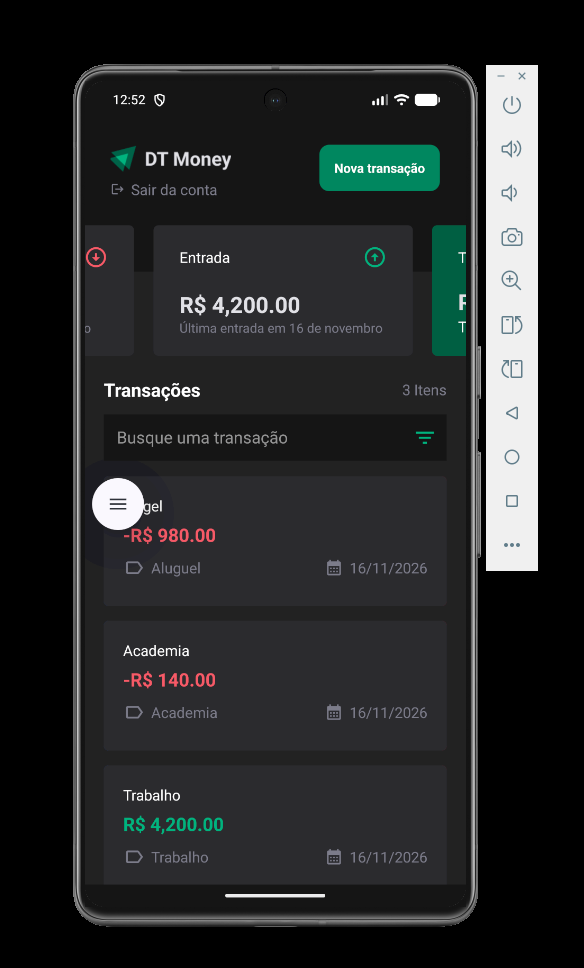
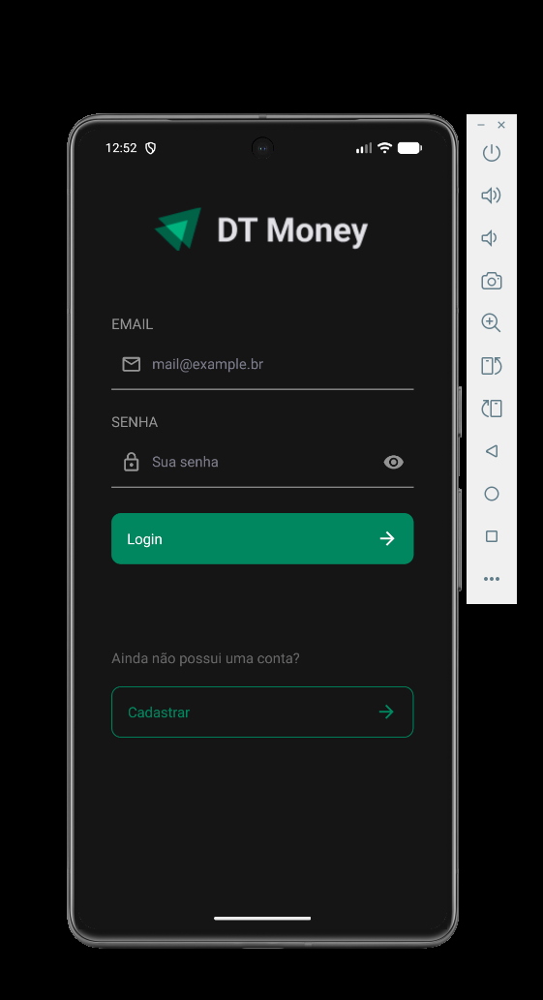
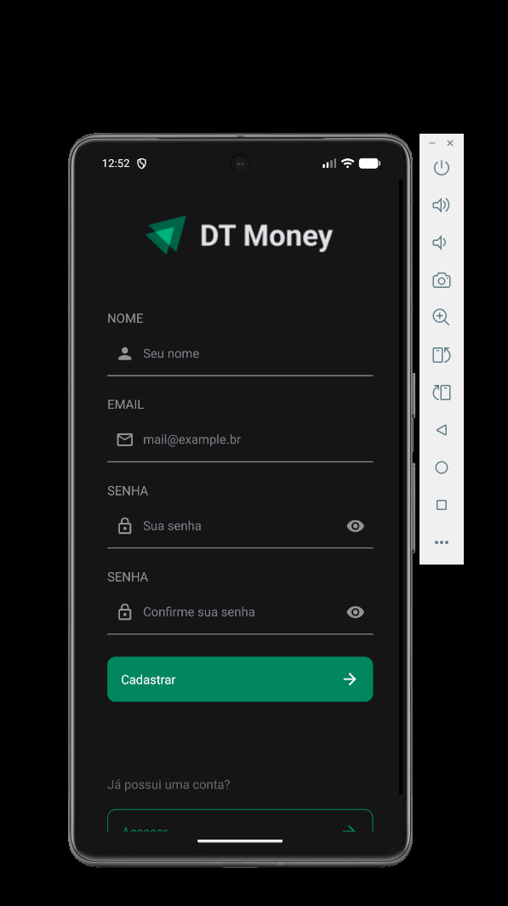
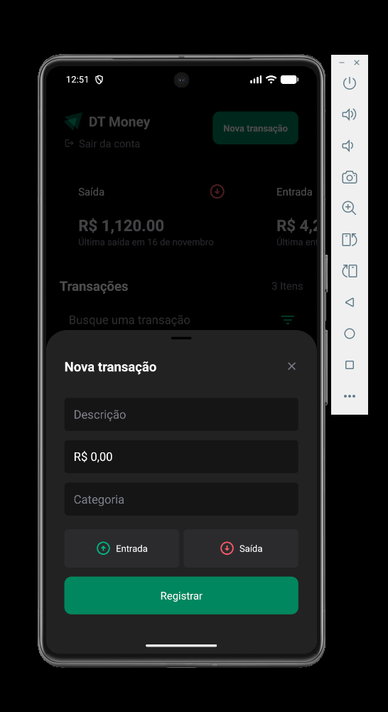
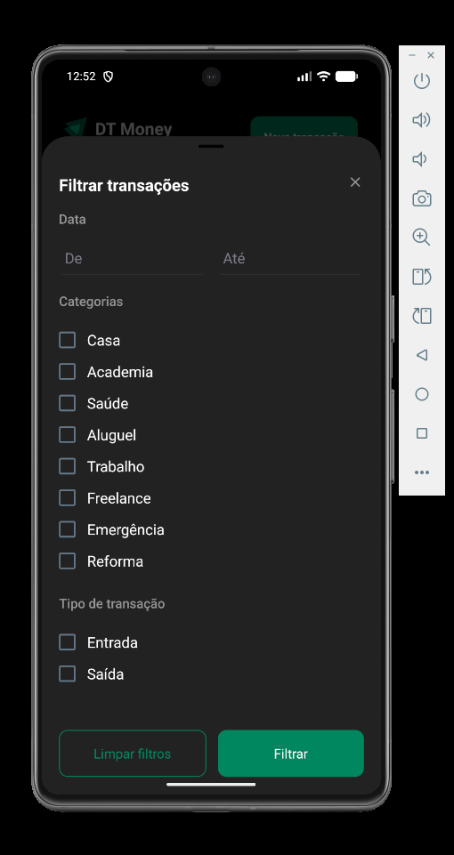

# 💰 DT Money

Aplicação Full Stack de gerenciamento financeiro, desenvolvida para facilitar o controle de receitas e despesas de forma simples e organizada.

## 📱 Screenshots

### Dashboard

<p align="center">
  
</p>

### Autenticação

<p align="center">
  
  
</p>

### Gerenciamento financeiro

<p align="center">
  
  
</p>

## 🚀 Tecnologias utilizadas

### Backend
- Node.js
- TypeScript

### Frontend
- React Native
- Expo
- TypeScript
- NativeWind
- Tailwind CSS

## ✨ Funcionalidades

- Cadastro e autenticação de usuários
- Cadastro de transações
- Filtros de transações por data e categoria
- Classificação de receitas e despesas
- Gerenciamento financeiro

## 📂 Estrutura do projeto

```text
dt-money/
├── backend/
│   └── ...
│
├── frontend/
│   └── ...
│
├── screenshots/
